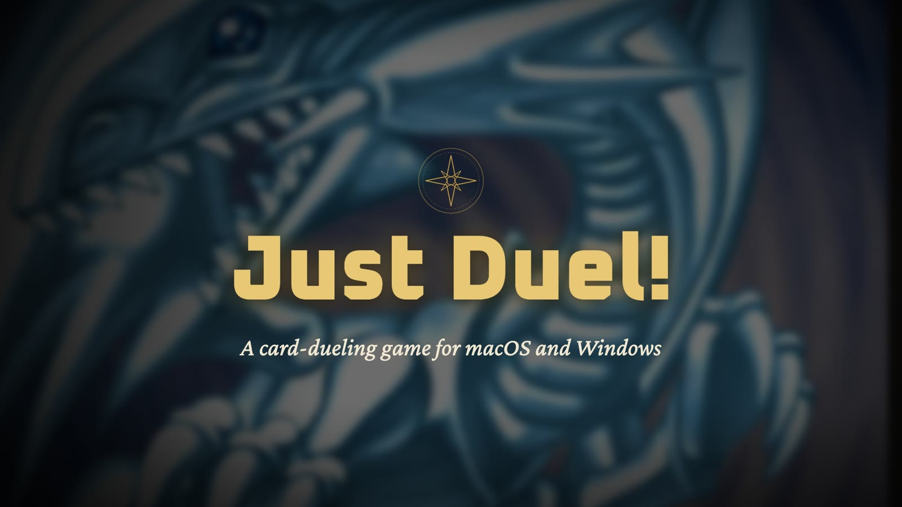
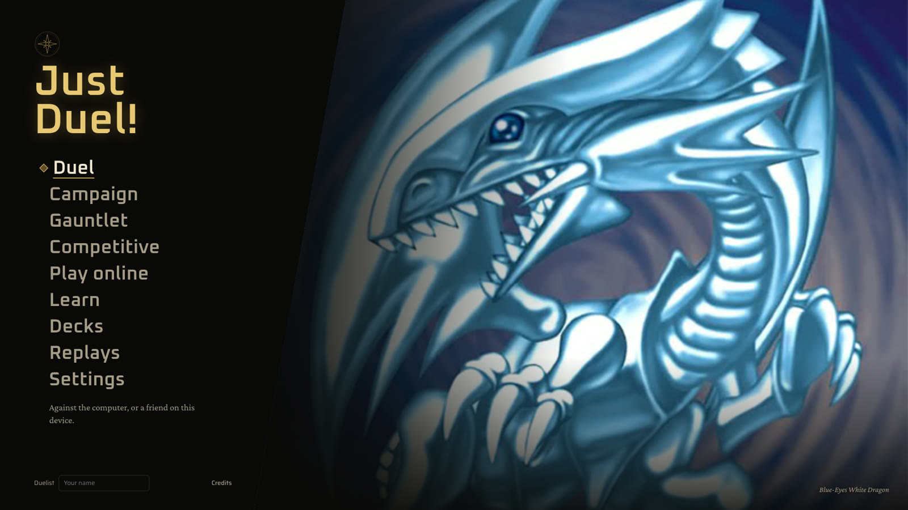
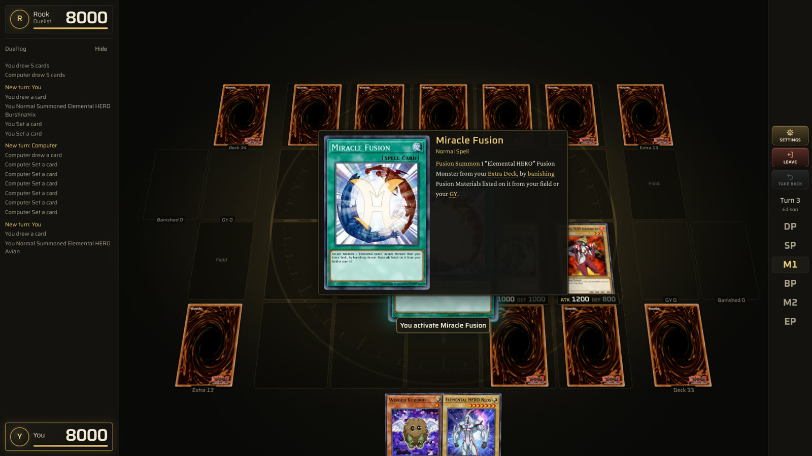
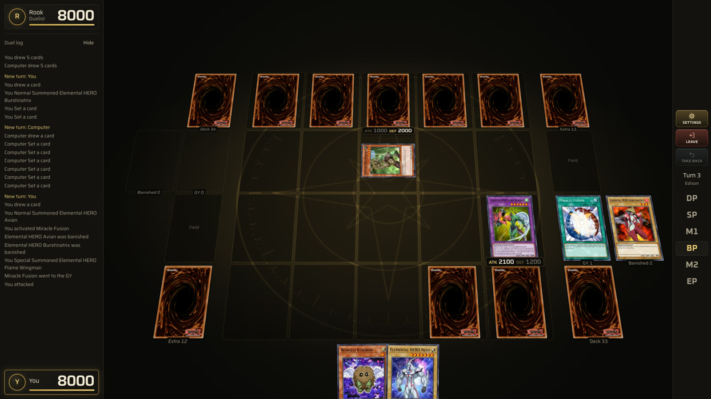
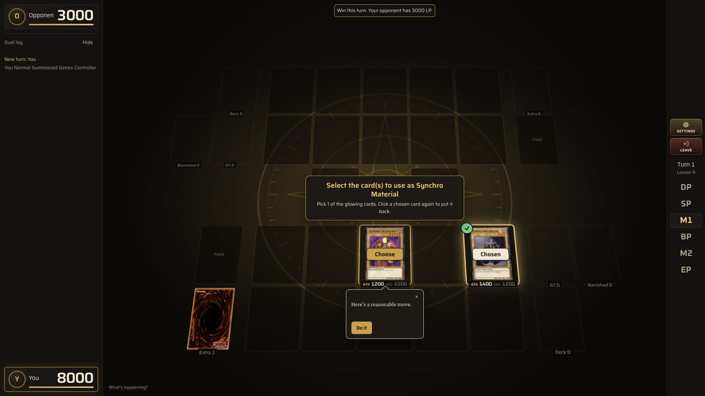
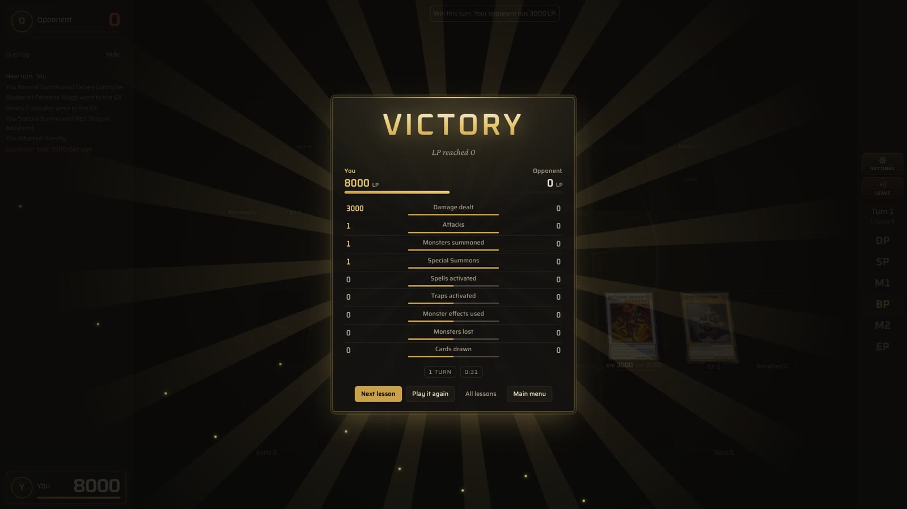
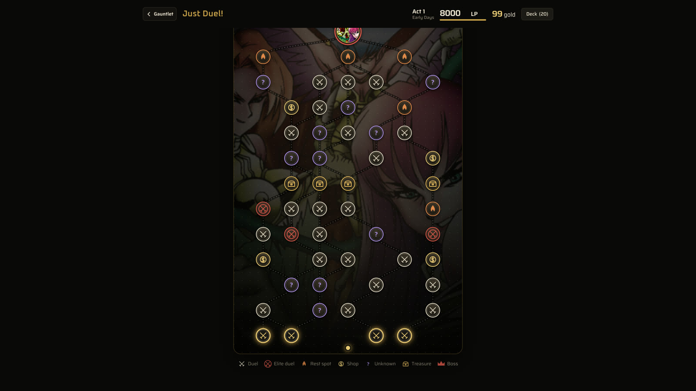
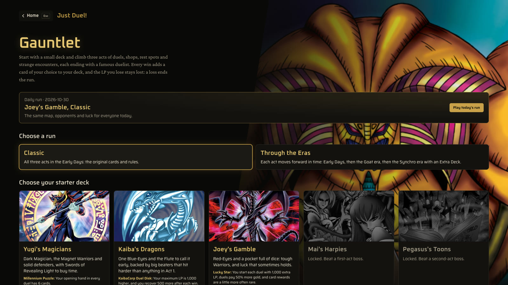
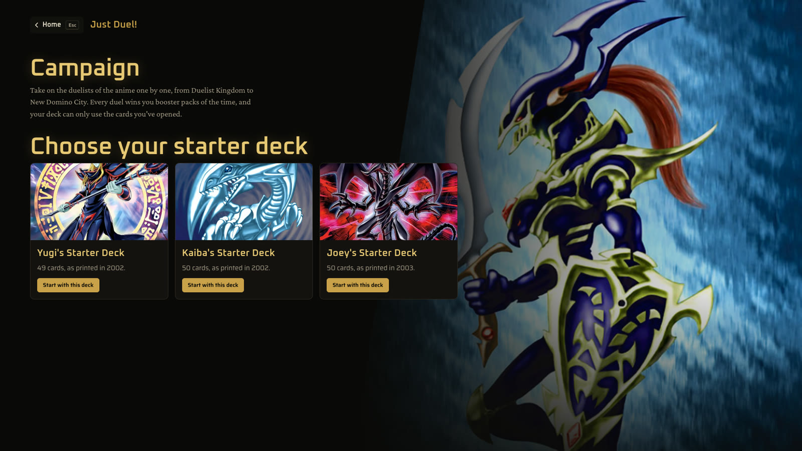
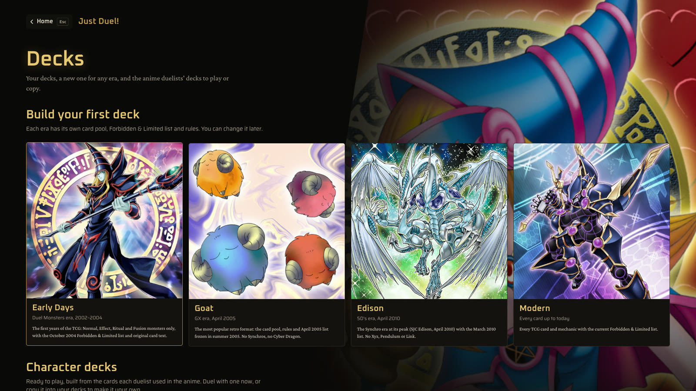

▶ <a href="media/just-duel-trailer.mp4">Watch the 22-second trailer</a>

# Just Duel!

**A card-dueling game for macOS and Windows.** 
Duel the computer or your friends on a 3D table, with a real rules engine behind every card.

    

[**Download**](https://github.com/ramiejleh/just-duel-releases/releases/latest) · [Features](#features) · [Screenshots](#screenshots) · [Install](#install) · [FAQ](#faq)

---

## Features

### 🃏 Every card plays by the real rules
Rulings come from **EDOPro's open-source engine** (Project Ignis's ocgcore, compiled to WebAssembly), so every card does exactly what it says: chains, timing, Fusion, Ritual, Synchro, Xyz, Pendulum and Link. Duel in **four eras**, each with its own card pool and Forbidden & Limited list:

| Era | What it is |
|---|---|
| **Early Days** | 2002–2004: Normal, Effect, Ritual and Fusion Monsters, original card text |
| **Goat** | April 2005: the most popular retro format |
| **Edison** | April 2010: Synchros at their peak |
| **Modern** | Every card and mechanic, with today's list |

### ⚔️ A table that feels like a game
A tilted 3D duel table (or a flat top-down one). Cards leap to the centre when summoned or activated, monsters lunge to attack, life points drain, and destroyed cards shatter. Opponents have names and things to say. Drag cards to play them, and point at any card to read it up close.

### 🎓 A coach at your side
**12 short lessons** take you from your first Normal Summon to Link Monsters, including four for players who only know the original game. In any duel against the computer, a coach can explain the rules, give a hint when you ask, or suggest every move with the reason why.

### 🗺️ Ways to play
- **Duel:** the computer (Easy, Medium or Hard) or a friend on the same device, with your decks or a ready-made character deck.
- **Campaign:** take on the anime's duelists across four chapters, win booster packs from the sets of the time, and build your deck from the cards you open.
- **Gauntlet:** a roguelike. Start with a small deck, travel a branching map of duels, shops, rest spots and events, collect relics, and beat a boss at the end of each of three acts. Includes a daily run, shareable seeds and Ascension levels.
- **Online:** play a friend through a room code (peer to peer, no account), or over your home network with the desktop app.
- **Ranked:** ranked duels with friends, using the decks you built in the Campaign.

### 🛠️ And the rest
- **Deck builder:** search and filters, legality checks for each era, sample hands, and YDK / ydke import and export.
- **Replays:** watch your last 30 duels again, or send one to a friend with a share code.
- **Take back** your last move against the computer.
- **Updates in one click:** the game checks this page and installs small patches from its title screen.
- **Plays offline:** every card and image ships with the app.

## Screenshots

<table>
  <tr>
    <td width="50%"> <b>Duel:</b> an activated card jumps to the centre with its text.</td>
    <td width="50%"> <b>The 3D table:</b> zones, LP, phases and a duel log.</td>
  </tr>
  <tr>
    <td> <b>Learn:</b> the coach walks you through a Synchro Summon.</td>
    <td> <b>Victory:</b> every duel ends with its stats.</td>
  </tr>
  <tr>
    <td> <b>Gauntlet:</b> pick your path to the act's boss.</td>
    <td> <b>Gauntlet:</b> starter decks, each with its own relic.</td>
  </tr>
  <tr>
    <td> <b>Campaign:</b> start with a deck as it was printed.</td>
    <td> <b>Decks:</b> build for any of the four eras.</td>
  </tr>
</table>

## Install

Open the [**latest release**](https://github.com/ramiejleh/just-duel-releases/releases/latest) and download the file for your computer.

| System | Download | First launch |
|---|---|---|
| **macOS** (Apple silicon) | `Just.Duel.-<version>-arm64.dmg` | Drag Just Duel! to Applications. The app isn't signed: the first time, right-click it and choose **Open**. |
| **Windows** (x64) | `Just.Duel.Setup.<version>.exe` (installer) or `Just.Duel.-<version>-win.zip` (no install) | If Windows says it "protected your PC", choose **More info**, then **Run anyway**. |

**Updates:** once installed, the game checks for new versions and offers them on its title screen. Most updates are a 4 MB patch, installed with **Update now**.

Your decks and progress stay on your computer, in `~/Library/Application Support/Just Duel!` (macOS) or `%APPDATA%\Just Duel!` (Windows).

## FAQ

**Is it free?** Yes. There's nothing to buy, no ads and no account.

**Do I need to know the game?** No. Start with **Learn**: the first lessons teach summoning, attacking and Spells, and the coach can stay on in any duel.

**Can I play with a friend on another computer?** Yes. Choose **Play online**, host a room and send your friend the code. On the same network, the desktop app can also host over LAN.

**Where's the source code?** This repository only holds the builds. The source isn't published.

## Credits

- **Rules engine:** [ocgcore](https://github.com/edo9300/ygopro-core) and [card scripts](https://github.com/ProjectIgnis/CardScripts) by Project Ignis (AGPL-3.0), via [ocgcore-wasm](https://github.com/n1xx1/ocgcore-wasm) (MIT).
- **Card data and images:** [YGOPRODeck](https://ygoprodeck.com/).
- **Music:** "Battle" by Peter Eastman (CC-BY 3.0), "Battle Theme A" by Alex Smith / cynicmusic (CC0), and arrangements from OverClocked ReMix. The trailer uses "Battle" by Peter Eastman.
- **Sounds:** Casino Audio by Kenney (CC0). **Fonts:** Oxanium, Saira and Crimson Pro (SIL OFL).

The full list is on the game's **Credits** screen.

---

Just Duel! is a free, unofficial fan project. It is not affiliated with, endorsed or sponsored by Konami. Yu-Gi-Oh! card names, text and artwork are © Konami / 4K Media / Kazuki Takahashi / Shueisha.
